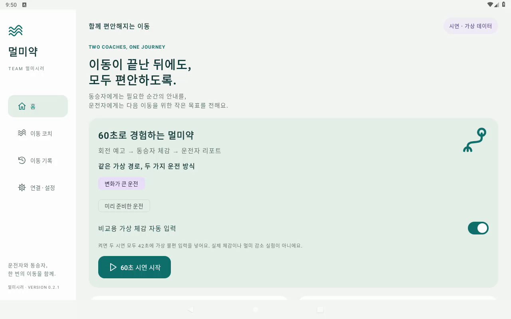
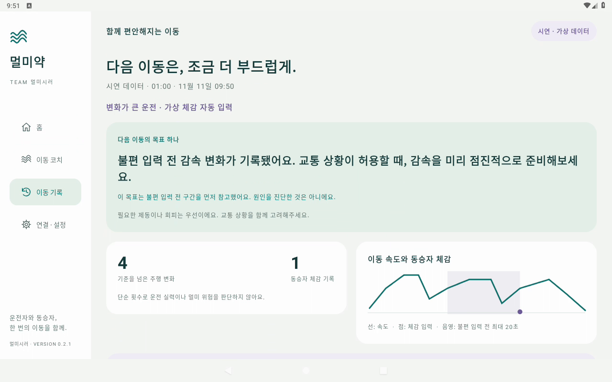

# 멀미약 · MotionCoach

**동승자에게는 다음 움직임의 짧은 안내를, 운전자에게는 다음 이동에서 실천할 목표 하나를 전하는 Android 앱.**

현대자동차그룹 차량용 앱 개발 공모전용 프로토타입입니다. 팀명은 **멀미시러**입니다.

[68초 시연 영상 보기](demo/%EB%A9%80%EB%AF%B8%EC%8B%9C%EB%9F%AC_%EB%A9%80%EB%AF%B8%EC%95%BD_%EC%8B%9C%EC%97%B0%EC%98%81%EC%83%81.mp4) · [Android 9 이상 APK 다운로드](apk/%EB%A9%80%EB%AF%B8%EC%8B%9C%EB%9F%AC_%EB%A9%80%EB%AF%B8%EC%95%BD_release.apk?raw=true)

버전 0.2.2 · 앱 ID와 서명 키를 유지해 이전 버전 위에 업데이트할 수 있습니다.

0.2.1에서는 앱명을 **멀미약**, 팀명을 **멀미시러**로 변경했습니다. 설치 이름, 앱 화면, 동승자 페이지 제목과 시연영상에 반영했으며 코칭 로직은 0.2.0과 같습니다.

## 이번 버전의 개선

- 불편 입력 직전 최대 20초의 차량 변화를 먼저 참고해 운전 목표를 선택합니다. 원인을 진단하지 않습니다.
- 리포트에 검토 구간 음영, 가속·감속·조향 횟수와 안내 이력을 표시합니다. 겹친 구간은 목표 선택에서 중복 집계하지 않습니다.
- 같은 가상 경로의 ‘변화가 큰 운전’과 ‘미리 준비한 운전’을 선택할 수 있습니다.
- ‘비교용 가상 체감 자동 입력’을 켜면 두 시연 모두 42초에 가상 불편 입력을 넣습니다. 실제 동승자 입력이나 효과 실험이 아닙니다.
- 음성은 동승자 대상의 짧은 안내로 바꾸고, 행동 설명은 이동 첫 안내에만 덧붙입니다.
- 0.2.2부터 우회전·좌회전·방지턱·내리막과 휴식 요청에 앱에 포함된 한국어 음성을 사용합니다. **연결 · 설정 → 음성 안내 → 안내 음성 미리 듣기**에서 첫 우회전 안내를 확인할 수 있습니다.





## 실행하기

1. `apk/멀미시러_멀미약_release.apk`를 Android 9(API 28) 이상 기기에 설치합니다.
2. 홈의 **60초 시연 시작**을 누릅니다. 시연은 별도 계정·네트워크·실차 없이 동작합니다.
3. 회전·방지턱 안내를 확인하고 **조금 불편해요** 등을 눌러 체감을 남깁니다.
4. 60초가 지나거나 **종료 · 리포트**를 누르면 같은 시간축의 주행 변화와 동승자 체감, 다음 이동 목표가 표시됩니다.
5. **이동 기록**에서 최근 10회를 다시 열고 JSON으로 내보낼 수 있습니다.

시연은 모든 화면에 **시연 · 가상 데이터**라고 표시됩니다. 차량 연결을 입증하는 기능이 아니라 앱의 전체 흐름을 경험하는 모드입니다.

```powershell
adb install -r "apk/멀미시러_멀미약_release.apk"
adb shell am start -n app.motioncoach/.MainActivity
```

## 두 코치의 역할

| 시점 | 동승자 코치 | 운전자 코치 |
| --- | --- | --- |
| 출발 전 | 동승자 휴대폰 연결, 음성 간격 설정 | 정차 상태에서 이동 기록 시작 |
| 이동 중 | 회전·방지턱 근접 안내, 정면 먼 곳 보기 제안, 체감·휴식 요청 | 주행 변화 기록. 점수·그래프 조작은 정차 후 |
| 도착 후 | 자신의 체감 기록 돌아보기 | 주행 변화와 체감을 함께 보고 다음 이동 목표 하나 확인 |

## Pleos 연결 모드

### 개발·테스트 환경

- Pleos Connect 이미지: **release_connect_v2.1.0 (Android 14)**, 화면 **1280×720**, Windows WHPX, 테스트 RAM 2GB. 0.1.0에서 설치·실행과 정차 상태의 속도·조향 신호 수신을 확인했습니다. 자세한 범위는 [Pleos 검증 기록](docs/VALIDATION_0.1.md)을 참고하세요.
- 제출 영상의 앱 화면은 0.2.1에서 녹화했습니다. **AOSP Android 9(API 28), 1280×800**, RAM 1GB의 가상 시연 모드에서 확인했습니다.
- 0.2.2의 안내 음성은 오프라인으로 재생됩니다. 휴대폰에서 미리 듣기 소리가 작으면 미디어 음량과 블루투스 출력 장치를 확인하세요.

**연결 · 설정 → Pleos 차량**에서 사용합니다. Pleos Connect/Android Automotive 환경, 해당 서비스와 권한이 필요합니다. 일반 휴대폰에서는 연결 불가 상태와 시연 사용 안내를 표시합니다.

| 입력/기능 | 구현 경로 | 한계 |
| --- | --- | --- |
| 속도 | AAOS `CarPropertyManager`, `PERF_VEHICLE_SPEED` | 권한 또는 속성 미지원이면 미수신 |
| 종가속도 | 속도의 시간 변화량 + 평활화 | 직접 가속도 센서값 아님. 노면·뒷좌석 흔들림을 측정하지 않음 |
| 핸들 조향각 | Vehicle SDK `getCurrentSteeringWheelAngle()` | 횡가속도가 아니며 지원 차종/서비스에 의존 |
| 다음 회전/주의 지점 | NaviHelper `TBTInfo`, `CautionPoint` | 전체 경로 곡률·멀미 최적 경로를 제공하지 않음 |
| 안내 시점 | 남은 거리 ÷ 현재 속도, 약 3~12초 범위 | 정속 근사. 급감속·경로 변경에 따라 오차 발생 |
| 음성 | APK 내 한국어 음원, Android `MediaPlayer`, 내비게이션 안내용 오디오 포커스 | 통화 등으로 오디오 포커스를 얻을 수 없으면 해당 안내의 화면 표시만 제공 |
| 주행 중 화면 제한 | AAOS `CarUxRestrictionsManager` + P단/속도 | 미확인 상태에서는 조작 잠금. 플랫폼 자체가 앱을 차단할 수도 있음 |

차량 제어 API는 사용하지 않습니다. 연결 실패/누락 신호를 가상 값으로 보충하지 않습니다. 실차나 SDK 서비스의 동작 검증 범위는 [검증 기록](docs/VALIDATION.md)을 확인하세요.

차량 모드 사용 전 기본 내비게이션에서 경로 안내를 시작한 뒤 앱으로 돌아옵니다. 정차 상태에서 기록을 시작합니다. 주행 제한 상태에서는 설정·기록·체감 버튼과 메뉴를 숨기고 짧은 비대화형 안내만 표시합니다. 이 동작을 위해 Activity에 DO(`distractionOptimized`)를 선언했습니다. 이 선언은 플랫폼 인증이나 실차 안전성 검증을 받은 것을 의미하지 않습니다.

현재 앱은 전경 실행을 전제로 합니다. 앱을 벗어나면 기록을 종료하고 중단 리포트를 저장하며 동승자 연결을 닫습니다. 백그라운드 운행 서비스, 자동 출발·도착, 실제 멀미 예측 모델은 구현하지 않았습니다. 강제 종료·프로세스 강제 제거 직전의 진행 중 기록은 복구되지 않습니다.

## 동승자 휴대폰

정차 중 **연결 · 설정 → 동승자 연결 시작**을 누른 뒤, 차량과 같은 신뢰할 수 있는 Wi-Fi에 연결된 동승자 휴대폰에서 표시 주소를 엽니다. 별도 설치 없이 현재 안내와 체감 버튼이 나타납니다. 앱으로 돌아와 이동을 시작하면 입력할 수 있습니다. 운전자용 기능이 아닙니다.

로컬 HTTP 시제품입니다. 공유 링크를 아는 사람은 입력할 수 있으므로 공개 Wi-Fi에서 사용하지 마세요. 이름·위치·주행 이력은 서버로 제공하지 않으며 인터넷 클라우드에 전송하지 않습니다. 제품화 시 TLS·명시적 페어링 승인·네트워크 정책 검토가 필요합니다.

에뮬레이터의 가상 네트워크에 휴대폰이 접근하지 못하면 PC에서 다음처럼 포트를 전달할 수 있습니다.

```powershell
adb forward tcp:8765 tcp:8765
# 앱에서 표시된 주소의 호스트 부분만 127.0.0.1로 바꿔 PC 브라우저에서 엽니다.
# 예: http://127.0.0.1:8765/p/<앱에서 생성된 토큰>
```

## 빌드

JDK 17, Android SDK Platform 35 / Build Tools 35.0.0, 인터넷 연결이 필요합니다. `minSdk 28`, `targetSdk 34`, Gradle 8.10.2, AGP 8.8.2, Kotlin 1.9.25, Compose를 사용합니다. Pleos 공식 Maven 저장소에서 Vehicle 2.3.2와 NaviHelper 3.0.5를 받습니다.

1. Android Studio로 이 폴더를 엽니다.
2. `local.properties`에 본인 PC의 `sdk.dir`을 설정합니다. 이 파일은 Git에 올리지 않습니다.
3. 테스트와 디버그 빌드:

```powershell
.\gradlew.bat :app:testDebugUnitTest :app:assembleDebug
```

4. 제출용 서명 키를 생성하거나 본인의 기존 키를 사용합니다. [서명 및 release 빌드](docs/BUILD_RELEASE.md)를 따릅니다.

```powershell
.\gradlew.bat :app:assembleRelease
```

개인 서명 파일·비밀번호는 소스 저장소/ZIP에 포함하지 않습니다. `signing.properties`가 없으면 release는 서명되지 않으므로 그대로 제출하거나 설치할 수 없습니다.

## 검증과 제출

- [실행 검증 기록 및 남은 과제](docs/VALIDATION.md)
- [GitHub 업로드와 제출 준비](docs/SUBMISSION.md)
- [영상 제작용 60초 시연 순서](docs/DEMO_SCRIPT.md)
- [판단 기준과 데이터 설명](docs/ALGORITHM.md)

## 개인정보와 효과 표현

최근 10회의 속도·조향 스냅샷, 이벤트 시간, 동승자 체감이 기기 내부에 저장됩니다. 계정·GPS 위치·음성 녹음은 수집하지 않습니다. 기록 삭제 버튼을 제공합니다. JSON을 직접 내보내면 그 파일은 별도 관리해야 합니다.

이 앱은 멀미 진단, 멀미 확률 산출 또는 안전 운전 점수를 제공하지 않습니다. 멀미 감소 효과는 검증되지 않았습니다. 필요한 제동·회피 등 도로 안전 판단이 우선이며, 주행 변화와 불편 기록의 시간적 근접성을 인과관계로 해석하지 않습니다.

## 공식 근거

2026-11-11 확인:

- [공모전 제출 안내](https://appdevchallenge.auto-hmg.io/guide/submission)
- [개발 환경](https://appdevchallenge.auto-hmg.io/guide/development)
- [Pleos NaviHelper 초기화](https://document.pleos.ai/docs/pleos-only/connect-sdk-pleos/NaviHelper/initialization-and-release)
- [NaviHelper 권한](https://document.pleos.ai/docs/pleos-only/connect-sdk-pleos/NaviHelper/declaring-permissions)
- [주행 규제 개발 가이드](https://document.pleos.ai/docs/pleos-only/vehicle-app-developer-guide/driving-restriction-development-guide)

이 저장소의 앱 코드는 출품 팀이 관리합니다. 제3자 라이브러리·SDK는 각각의 이용 조건을 따릅니다. 공식 차량 앱 또는 현대자동차그룹의 인증을 받은 제품을 의미하지 않습니다.
